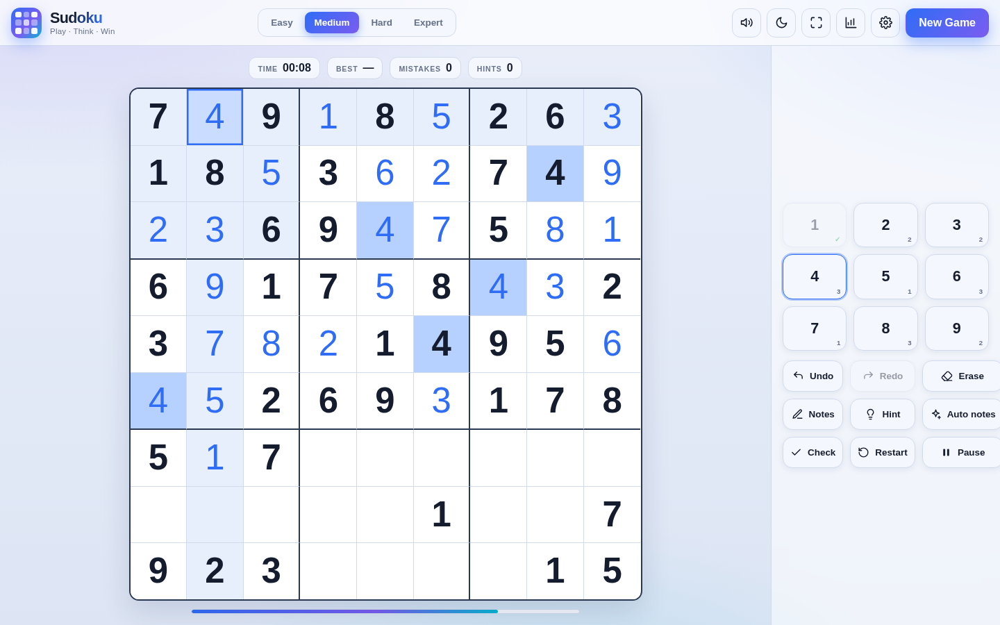

# Sudoku

A full-screen Sudoku game in a single HTML file — no build step, no dependencies, works offline.



## Run

Open `sudoku.html` in a browser. To serve it locally:

```
python3 -m http.server
# http://localhost:8000/sudoku.html
```

## Features

- Four difficulties: Easy, Medium, Hard, Expert
- Every puzzle has exactly one solution — generated and verified, never ambiguous
- Notes, auto-notes, and notes that clear themselves when a digit is placed
- Undo / redo, erase, hint, check, restart
- Mistake counter with an optional limit (off / 3 / 5)
- Timer with pause, and auto-pause when you switch tabs
- Best time per difficulty, plus full statistics
- Your game is saved — resume after closing the tab
- Confetti on a win, sound effects, light/dark theme, fullscreen
- Playable by keyboard; responsive from phone to widescreen

## How to play

Fill the grid so every row, every column and every 3×3 box contains 1–9 exactly once.

## Keyboard

| Key | Action |
| --- | --- |
| `1`–`9` | Place a number |
| Arrow keys | Move selection |
| `Backspace` / `Delete` / `0` | Erase |
| `N` | Notes mode |
| `H` | Hint |
| `U` / `R` | Undo / redo |
| `C` | Check the board |
| `A` | Auto notes |
| `P` / `Space` | Pause |
| `Esc` | Close a panel |

## Tech

One HTML file: HTML, CSS and vanilla JavaScript, with inline SVG icons and no external libraries or fonts. The engine is a randomized backtracking generator with a solution counter for uniqueness checking. Settings, statistics and the saved game are kept in `localStorage`.

## License

For personal and educational use.
